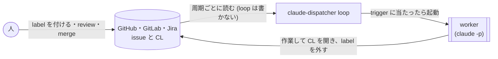
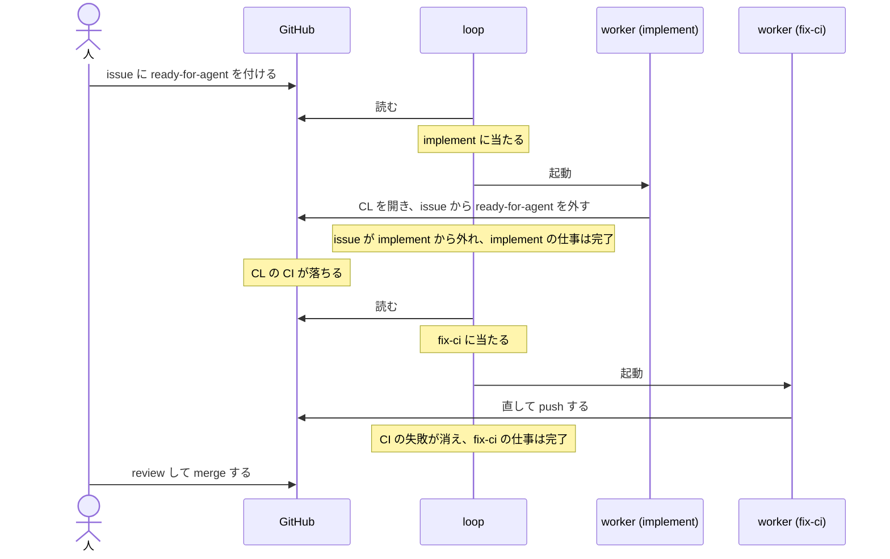

# claude-dispatcher

GitHub・GitLab・Jira の issue に label (Jira では status) で印を付けておくと、Claude Code が無人で実装して CL (GitHub の pull request・GitLab の merge request) を出す CLI。CL の conflict・review の指摘・CI の失敗を手直しする作業も、同じ仕組みで任せられる。どの issue や CL に何をさせるかは、repo に置く workflow 定義 (`WORKFLOW.md`) に書く。

## 仕組み



人が issue に label を付ける (Jira では status を移す) と、loop (端末で動かし続ける claude-dispatcher の process) が周期ごとに issue と CL を読み、workflow 定義の trigger に当たったものへ worker (loop が無人で起動する Claude Code) を起動する。worker は action のとおりに作業して CL を開き、label を外す。人はその CL を review して merge する。loop 自身は issue にも CL にも何も書かない。

- **trigger** は、「どんな issue や CL に反応するか」(`when`) と、そのとき worker に渡す prompt (**action**) の組。workflow 定義に上から並べ、最初に当たった 1 つで worker を起動する
- **worker は作業を終えたら、自分を起動した trigger から issue や CL を外す** (label を外すなど)。外れないまま worker が終わると、loop は間を置いて同じ worker にやり直させ、やり直しの上限に達したら止めて `status` の `要対処` に出す。決まりの詳細は `claude-dispatcher guide` の「action が守る約束」
- **loop は止めるまで端末で動き続ける**。cron などには登録しない。止めるのも起動し直すのも人が行う

## 例: 1 件の issue が merge されるまで



人が issue に `ready-for-agent` を付けると、loop は issue を読み、`implement` に当たったので worker を起動する。worker は CL を開き、issue から `ready-for-agent` を外して仕事を終える。CL の CI が落ちると今度は `fix-ci` に当たり、別の worker が直して push する。最後に人が review して merge する。

`setup` が書く雛形には、issue を実装する `implement` と、CL の conflict・review・CI を手直しする trigger が入っている。

## 前提

- macOS か Linux
- [Claude Code](https://docs.claude.com/en/docs/claude-code) と、その認証
- git
- issue を置くサービスの CLI と、その認証 (下の表)
- action の先頭に書く skill と command (`/swat-skills:playbook-implementation` など) を、worker が呼べる場所 (plugin・repo の `.claude/`・`~/.claude/`) に入れておく。特定の plugin には依存しない。呼べない名前は、起動の前の検査で名指しされる

| issue を置くサービス | CLI | 認証 |
|---|---|---|
| GitHub | [gh](https://cli.github.com/) | `gh auth login` か、workflow 定義の `tracker.token` |
| GitLab | [glab](https://gitlab.com/gitlab-org/cli) | `glab auth login` か、workflow 定義の `tracker.token` |
| Jira Cloud | [acli](https://developer.atlassian.com/cloud/acli/) (CL 側の CLI は下の Jira の注意) | `acli jira auth login` |

GitLab は、issue と merge request を同じ project に置く構成を扱う。対象とする GitLab の版は、GitLab が security 修正を出している版 ([maintenance policy](https://docs.gitlab.com/policy/maintenance/) の、最新の minor から 3 つ)。

<details>
<summary>Jira Cloud を使うときの注意</summary>

- Jira Cloud の 1 つの project に issue を置く (Data Center / Server は扱わない)。CL を置く場所は workflow 定義の `cl:` で GitHub か GitLab を宣言し、その CLI (gh か glab) とその認証も用意する。worker もその CLI で CL を開く
- 1 つの Jira project は、1 本の loop と 1 つの repo で回す。component や JQL で 1 つの project を複数の repo に分けて回すことはできない (同じ project の 2 本目の loop は起動時に止まる)
- acli で今使っている account の site を、workflow 定義の `tracker.host` に書いておく。acli は呼び出しごとに site を選べないので、loop は起動時に site が違えば止まる (`acli jira auth switch --site <site>` で切り替える)
- acli は macOS では資格情報を keychain に置く。ssh 越しの shell では keychain が unlock されておらず、acli が認証を読めないことがある。そのときは `security unlock-keychain` を実行してから loop を起動するか、API token で `acli jira auth login` をし直す

</details>

## install

Homebrew・`go install`・GitHub Releases の binary のどれかで入れる。

**Homebrew** (macOS / Linux):

```sh
brew install --cask swat9013/tap/claude-dispatcher
brew upgrade --cask swat9013/tap/claude-dispatcher   # 新しい版が出たとき
```

動いている `loop` は起動した時点の binary で回り続けるので、`brew upgrade` の後は起動し直す。

<details>
<summary>Homebrew の補足</summary>

- tap 名を含む名前 (`swat9013/tap/claude-dispatcher`) で入れると、Homebrew の tap trust (第三者の tap の中身を読む前に求める明示の信頼) がこの cask にだけ与えられる
- binary は署名していないので、macOS では cask が install 時に quarantine (Gatekeeper の検査対象にする拡張属性) を外す

</details>

**`go install`** (Go は [go.mod](go.mod) の `go` 行の版以上):

```sh
go install github.com/swat9013/claude-dispatcher/cmd/claude-dispatcher@latest
```

<details>
<summary>GitHub Releases の binary を置く</summary>

[Releases](https://github.com/swat9013/claude-dispatcher/releases) から、OS と CPU に合う `claude-dispatcher_<version>_<darwin|linux>_<amd64|arm64>.tar.gz` を `checksums.txt` と一緒に取り、照合してから展開する。下は macOS (Apple silicon) の例で、置き場の `~/.local/bin` は PATH に入れておく。

```sh
gh release download -R swat9013/claude-dispatcher -p '*_darwin_arm64.tar.gz' -p checksums.txt
shasum -a 256 -c checksums.txt --ignore-missing   # Linux は sha256sum -c checksums.txt --ignore-missing
tar xzf claude-dispatcher_*_darwin_arm64.tar.gz claude-dispatcher
mkdir -p ~/.local/bin && install -m 755 claude-dispatcher ~/.local/bin/
```

binary は署名していない。macOS でブラウザから取った archive は Gatekeeper に起動を止められるので、`gh release download` か `curl -LO` で取る (ブラウザで取ったなら `xattr -d com.apple.quarantine ~/.local/bin/claude-dispatcher`)。

</details>

入れた版は `claude-dispatcher --version` で確かめる。不具合を報告するときは、この出力を添える。

## 導入

実装する repo の clone に移り、次の順に実行する。各手順で何が起き、何を確かめるかは `claude-dispatcher guide` の「導入の流れ」。

1. **雛形を置く**: `setup` が `WORKFLOW.md` の雛形を書く

   ```sh
   cd ~/src/widgets
   claude-dispatcher setup
   claude-dispatcher setup --kind jira --host acme.atlassian.net --repo WIDGETS   # issue を Jira に置くとき
   ```

2. **自分の project に合わせて書く**: trigger・action・hooks を直し、repo に commit する。書き方は `claude-dispatcher guide` の「workflow 定義の書き方」と「action が守る約束」(Claude Code に読ませて手伝わせてもよい)。この repo 自身の例は [`WORKFLOW.md`](WORKFLOW.md)
3. **試運転**: 何も起動せずに、worker を起動するはずの issue や CL を、当たる trigger と組にして示す

   ```sh
   claude-dispatcher loop --dry-run
   ```

   action まで 1 件で確かめるなら、trigger の名前と issue (か CL) を指して worker を 1 回だけ起動する。worker が終わった後に issue や CL が trigger から外れていれば、`run` は exit 0 で終わる。詳しくは `claude-dispatcher guide` の「導入の流れ」

   ```sh
   claude-dispatcher run implement issue#42
   ```

4. **導入を確かめる**: workflow 定義・issue の読み取り・要る CLI・起動の前の検査を確かめ、Claude Code の settings に要りそうな entry を示す

   ```sh
   claude-dispatcher doctor
   ```

## 回す

実装する repo の clone で `loop` を実行する。起動時の検査、`WORKFLOW.md` を直したときの効き方、起動し直しが要る場面は `claude-dispatcher guide` の「回す・見る・止める」の「回す」。issue や CL を置く場所を変えたときは同じ案内の「workflow 定義の書き方」、loop を起動した環境から gh や glab の認証を取れない (ssh 越しの session など) ときは「項目」の `tracker.token`。

```sh
cd ~/src/widgets
claude-dispatcher loop
```

## 動いているかを見る

loop を起動した端末の画面か、別の端末の `status` で見る。log と worker の出力の置き場は `paths --json` で引く。画面と `status` の読み方、やり直しの上限に達して止まった issue や CL (`status` の `要対処`) の戻し方は `claude-dispatcher guide` の「回す・見る・止める」の「見る」。

```sh
claude-dispatcher status
claude-dispatcher paths --json
```

## 止める

loop の端末で Ctrl+C を押す。worker が終わるのを待てないときはもう一度押す。1 回目と 2 回目のそれぞれで worker と作業の途中の成果がどうなるか、使うのをやめるときに消すものは `claude-dispatcher guide` の「回す・見る・止める」の「止める」。

## 開発に加わる

開発中の版の動かし方・品質チェック・commit と PR の規約は [`CONTRIBUTING.md`](CONTRIBUTING.md)。

## License

[MIT](LICENSE)
