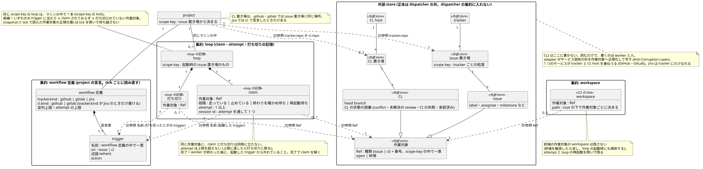
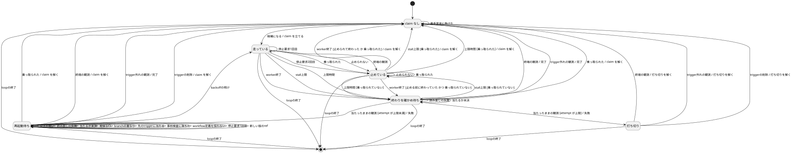

# 設計 doc

本ディレクトリが claude-dispatcher の設計の正本。実装の進行に合わせて最終形で書き換える (決定の理由は [`docs/adr/`](../adr/) に不変の記録として残す)。

## 索引

| file | 中身 |
|---|---|
| [`system.md`](system.md) | システム境界 / 全体図 / 解く問題 / 状態の表現 / 機械と LLM の線 / trigger / 起動・retry・打ち切り / workflow 定義 / 駆動 / worker に渡すもの / 配布と外部依存 / スコープ外 / CLI の seam |
| [`usecases.md`](usecases.md) | Cockburn 縮約テンプレートによるユースケース。冒頭に記述規約 |
| [`domain.puml`](domain.puml) | ドメインモデル図。entity・集約・多重度・不変条件と、各 entity の正本の持ち主 (外部 store / loop の記憶 / CLI の disk)。描画結果は `domain.svg` |
| [`statechart.puml`](statechart.puml) | claim の状態機械図。claim の段階と打ち切りが、どの出来事でどう遷移するかと、意図した未定義の組み合わせの理由。描画結果は `statechart.svg` |
| [`formats.md`](formats.md) | 外から観測できる形式。black-box テストの参照先 |
| [`internal/guide/guide.md`](../../internal/guide/guide.md) | 利用者のセッションへ出す案内。workflow 定義の書き方と、利用者向けの導入・運用の手順 (導入の流れ・回す・見る・止める・action が守る約束) の正本。後者は下の「設計を先に直す」が挙げる正本を利用者の語で書く。binary に埋め込み、`claude-dispatcher guide` が出す (ADR 0012)。本ディレクトリの外に置くのは embed のため |

用語は [`CONTEXT.md`](../../CONTEXT.md)。

## 設計を先に直す

構造を変えるときは、実装 (CLI のコード) より先に上の正本を直す。実装が先に着地すると、設計 doc が実装の後追い要約に落ちて正本でなくなる。

「先に」は commit の順を指す。同じ CL の中で、正本を直す commit を実装の commit より前に置き、実装と同じ commit に混ぜない。混ぜると、正本が実装より先に決まったのか、実装を後から要約したのかを review で見分けられない。

| 変えるもの | 正本 |
|---|---|
| 状態の表現と書き手、候補の定義式、機械と LLM の線、trigger の文法と評価の規則、起動・retry・打ち切り、workflow 定義の項目と検査の姿勢、駆動、worker に渡すもの、配布と外部依存、CLI の seam (部品の責務と seam の位置) | `system.md` |
| ユースケース | `usecases.md` |
| entity・集約・多重度・不変条件 | `domain.puml` (直したら `domain.svg` を描き直し、下の検証シナリオを通し直す) |
| claim の段階と遷移 (どの段階でどの出来事にどの遷移があるか) | `statechart.puml` (直したら `statechart.svg` を描き直して対で commit する。網羅は gate が検査する)。遷移の条件と効果を決める規則は `system.md` §7 |
| 外から観測できる形式 | `formats.md` |
| workflow 定義の書き方 (項目・述語・template・何が誤りになるか・事前検査がどこを探すか) | `internal/guide/guide.md` (検査で CLI が何を出すかは `formats.md` §2.8・§2.9) |
| 利用者向けの導入の流れ・loop の回し方と見方と止め方・action が守る約束 | `internal/guide/guide.md` (仕組みの規則は `system.md` §7、ユースケースは `usecases.md` の UC-5・UC-6、`setup`・`doctor` の形式は `formats.md` §7.4、loop の画面・`status`・`paths` の形式は `formats.md` §6・§7.1–§7.3 が正本で、案内はそれを利用者の語で書く) |

`system.md` §7・`usecases.md` の UC-5・UC-6 を直して、案内の「導入の流れ」「回す・見る・止める」「action が守る約束」に書いた振る舞いが変わるなら、同じ CL で案内も直す。`formats.md` §6・§7.1–§7.3 を直して、案内の「見る」に書いた観測形式が変わるときも、同じ CL で案内も直す。`formats.md` §7.4 を直して、案内の「導入の流れ」に書いた `setup` の雛形の埋まり方・`doctor` が確かめるもの・警告する宣言をはじめ、振る舞いや形式が変わるときも、同じ CL で案内も直す。

振る舞いの変わらないリファクタリング・bug fix・実装内部だけの変更は先に直さなくてよい。迷ったら先に直す。決定を覆すときは ADR を新しく起こす (既存 ADR の本文は書き換えない)。

## ドメインモデル図

正本は [`domain.puml`](domain.puml)。`domain.svg` はそこから描いた生成物なので、直すのは `.puml` の側で、直したら `plantuml -tsvg docs/design/domain.puml` で描き直して対で commit する。描く plantuml は `scripts/plantuml.version` の版に固定している。構文 (`plantuml --check-syntax` の exit code。`-tsvg` は構文の誤りでも誤りの画像を出して exit 0 を返しうる) と、svg が固定した版で今の `.puml` から描かれたかは、commit 時の hook と CI が検査する (CONTRIBUTING.md の「gate」)。

entity に付けた印は、その entity の正本がどこにあるかを表す。`«外部 store»` の entity (issue・CL と、その置き場) は worker と人が書き、dispatcher は読むだけなので、正本は dispatcher の外にある。adapter は読むたびにそれを作業対象へ写すだけで、写しを持ち越さない (`system.md` §13)。dispatcher が書くものは 3 つ。loop の process と寿命を共にする `«loop の記憶»` (claim・打ち切り)、disk に残る `«CLI の disk»` (workspace)、調停 remote を指した project でだけ実装 repo の git remote の独自 ref に置く `«調停 remote»` (着手宣言・生存報告。ADR 0011)。`«調停 remote»` は外部 store に機械が書く唯一の entity で、正本は remote の ref にあり、loop は他のマシンの loop との調停のためだけに読む (claim を remote から読み戻さない)。

## 検証シナリオ

ドメインモデル図が、具体の作業対象の遷移列を矛盾なく表せるかを確かめる。scope key はどれも `github.com/acme/widgets`、trigger は `implement` (issue 側) と `fix-ci` (CL 側)。

1. **正常系: issue の完了と、別の作業対象としての CL**
   1. `issue#42` が `implement` に当たる。loop に claim (`issue#42`, `implement`, attempt 1, 走っている, session `s-42a`) が立ち、workspace `issue-42` ができる
   2. worker が `CL#57` を開き、`issue#42` から着手可の label を外して終わる。claim は終わりを確かめ待ちになり、読み直した `issue#42` が `implement` から外れているので完了し、claim を解く。`issue#42` は open のままなので workspace `issue-42` は残る
   3. `CL#57` の CI が落ちて `fix-ci` に当たる。claim (`cl#57`, `fix-ci`, attempt 1) が立つ。`issue#42` と `cl#57` は種類の違う Ref なので、番号の空間を共有する GitHub でも、issue と merge request に別々に番号を振る GitLab でも取り違えない
   4. `CL#57` が merge され、`issue#42` が close される。終端を観測した tick が workspace `issue-42` を消す
2. **異常系: retry の上限で打ち切り、人が解く**
   1. `issue#43` の claim が attempt 1・2・3 (上限 3) と失敗する。3 回目の失敗で claim を解き、打ち切り (`issue#43`, `implement`) を立てる。同じ作業対象に claim と打ち切りが同時に立つ時点は無い
   2. 打ち切りの間は `issue#43` が `implement` に当たっても候補にならない。workspace `issue-43` は残る
   3. 人が label を外し、1 周期待ってから付け直す。外れたのを観測した tick が打ち切りを解き、次の tick で新しい claim (`issue#43`, `implement`, attempt 1) が立つ。attempt は新しい claim に積まれ、前の claim の数は引き継がない。workspace `issue-43` は同じ path のまま使う
3. **境界: loop の起動し直し**
   1. loop A に claim (`issue#44`, 走っている) と打ち切り (`issue#45`) がある。2 回の停止要求で worker を止め、loop A が止まる。claim と打ち切りは loop の記憶なので消える。workspace `issue-44` は disk に残る
   2. 同じ scope key で loop B を起動する。loop A がまだ動いていれば、scope key の lock で loop B は起動時に止まる (project 1 ─ 0..1 loop)
   3. loop B は起動時に終端の作業対象の workspace を掃除する。`issue#44` は open なので残す。`issue#44` が `implement` に当たったままなら、新しい claim (attempt 1) が立ち、同じ workspace の path で起動する。`issue#45` の打ち切りは消えているので、当たっていれば再び候補になる
   4. 別の場合: loop A が `issue#46` の worker の claude を止められないまま止まった (か、loop A が落ちた)。claim は loop A の記憶と一緒に消えるが、claude (orphan) は workspace `issue-46` を使い続ける。loop B の tick は、claim の無い workspace `issue-46` の orphan が生きているのを見て、`issue#46` が終端でも workspace を消さず、trigger に当たっていても claim を立てない。orphan は claim でも打ち切りでもないので、作業対象 1 ─ 0..1 claim の多重度は崩れない
   5. orphan が終わる。次の tick から `issue#46` は普通の掃除と候補の扱いに戻り、終端なら workspace を消し、当たっていれば claim (attempt 1) が立つ

4. **境界: マシンを跨いだ分担** (`coordination.remote: origin`)
   1. マシン A の loop `a-1a2b3c4d` とマシン B の loop `b-5e6f7a8b` が、それぞれ生存報告を置く。`issue#47` が `implement` に当たり、両方の候補になる
   2. 両方が着手宣言 (`issue#47`、持ち主 `a-1a2b3c4d`/`b-5e6f7a8b`) を「無いときだけ作る」で push し、A だけが通る。A に claim (`issue#47`, attempt 1) が立つ。B は claim を立てない。作業対象 1 ─ 0..1 着手宣言のまま
   3. A が落ちる。A の claim は A の記憶と一緒に消えるが、着手宣言と生存報告は remote に残る。B は A の生存報告が間隔の 3 倍新しくならないのを自分の時計で見て、A を死んだとみなす
   4. `issue#47` が当たったままなら、B は旧 sha を期待値にした置き換えで着手宣言を乗っ取り、claim (attempt 1) を立てる。attempt は A の数を引き継がない。B は A の生存報告を消す
   5. 別の場合: A は network が切れていただけで生きていた。network が戻った A は、自分の着手宣言の sha が変わったのを見て、`issue#47` の worker を止めて claim を解き、要対処に出す。A は B の着手宣言を消さない

4 シナリオとも、図の多重度 (作業対象 1 ─ 0..1 claim / 0..1 打ち切り / 0..1 workspace) と集約の境界 (loop の記憶は loop と共に消え、workspace と調停 remote の ref は残る) のまま表せる。起動は claim (loop 集約) と workspace を続けて作るが、両者をまたぐ不変条件は無い (シナリオ 3 のとおり、claim の無い workspace は普通に在る)。そのため、2 つを別々の集約のままにしておける。orphan の生死 (シナリオ 3 の 4・5) は図の entity でも集約でもなく、kernel が持つ worker log の flock にある。図には、候補の定義式と workspace の不変条件の注記にだけ現れる。

## claim の状態機械図

正本は [`statechart.puml`](statechart.puml)。作業対象 1 件について、loop の記憶 (claim と打ち切り) が出来事ごとにどう移るかを描く。状態は claim なし・claim の段階 4 つ・打ち切り、出来事は `system.md` §7 と §9 が挙げるもの (`workflow定義を採れない` は、§7 の読めない・文法に合わない版と、subcommand で渡した並列上限が読めない tick と、§9 の scope key が変わった版をまとめる)。

- **網羅の正本は図、規則の正本は §7**: どの「段階 × 出来事」にどの遷移があるかは図が持ち、遷移の条件と効果を決める規則 (backoff の式・再起動の前の読み直し・曖昧な CL の扱い 等) は §7 が散文で持つ。同じ遷移を図と §7 の両方に列挙しない。図の遷移のラベルは `出来事 [条件] / 出口` の形で、条件は同じ出来事で行き先が分かれるときだけ、出口は claim を出入りするとき (claim を立てる・完了・失敗・claim を解く・打ち切りを解く) だけ書く
- **§7・§9 が反応を定める組み合わせは自己遷移で描く**: 待ち直す・確かめ直すなど、段階を変えずに反応する組み合わせ
- **当てない組み合わせには理由を書く**: 遷移の無い組み合わせは、図の中に `' uncovered: <状態> x <出来事> — <理由>` の行で理由を書く。出来事の名前は空白を含めない (宣言が空白で切る)。状態は図の中の ASCII の alias で書く
- **直したら描き直して対で commit する**: 描き直し方は上のドメインモデル図と同じ (`plantuml -tsvg docs/design/statechart.puml`)。構文・描き直し漏れ・網羅は commit 時の hook と CI が検査する (CONTRIBUTING.md の「gate」)。網羅の検査は repo に vendor した `scripts/check-statechart.py` で、落ちる条件と読む範囲は `python3 scripts/check-statechart.py --help` が正本 (CONTRIBUTING.md の「gate」)。手元で撃つなら `python3 -I scripts/check-statechart.py docs/design/statechart.puml`
